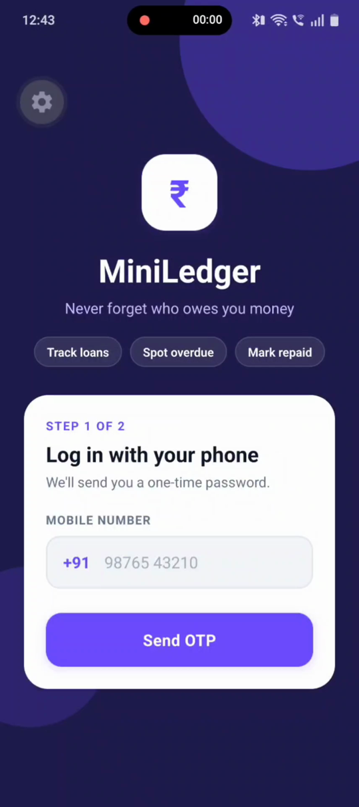
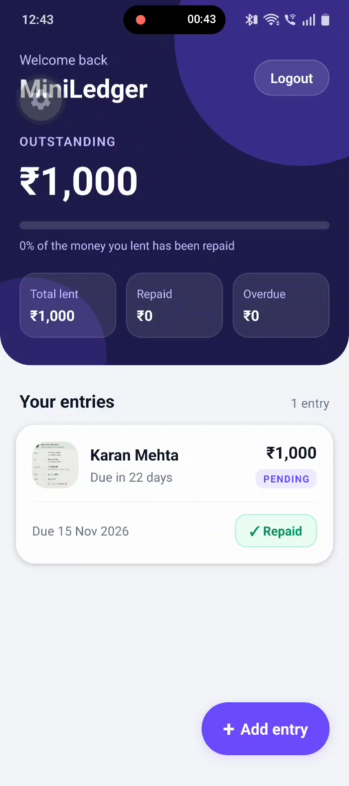
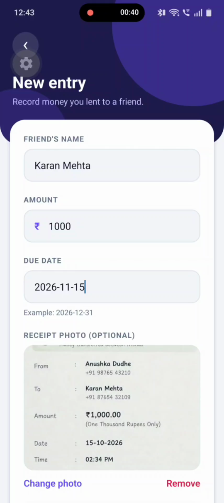
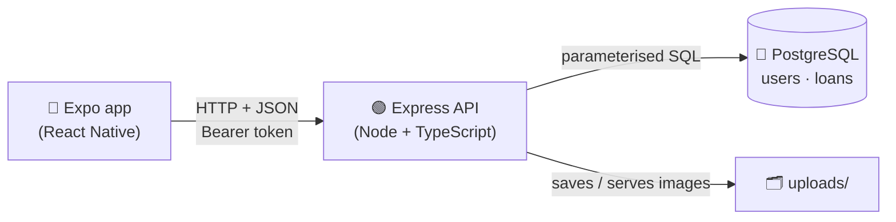
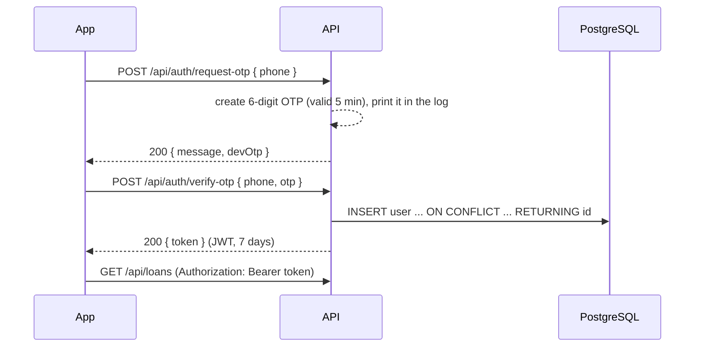
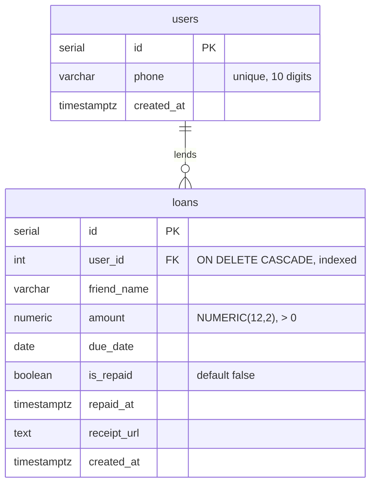

<div align="center">

# ₹ MiniLedger

**Never forget who owes you money.**

A small full-stack app to keep track of money you lend to friends:<br>
log in with your phone, record who borrowed what, and see at a glance what is still outstanding or overdue.


[Features](#-features) ·
[Screenshots](#-screenshots) ·
[Demo](#-demo-video) ·
[Getting started](#-getting-started) ·
[API](#-api-reference) ·
[Design decisions](#-design-decisions)

</div>

---

## ✨ Features

| | Feature | Details |
| :-: | --- | --- |
| 📱 | **Phone + OTP login** | Enter an Indian mobile number, get a one-time password, stay logged in with a 7-day token |
| ➕ | **Add an entry** | Friend's name, amount, due date and an optional receipt photo |
| 🔴 | **Overdue highlighting** | Unpaid entries past their due date turn red with an **OVERDUE** label |
| ✅ | **Mark as repaid** | One tap (with a confirmation); repaid entries turn green |
| 📊 | **Summary card** | Outstanding amount, a "% repaid" progress bar, and total lent / repaid / overdue |
| 🧾 | **Receipt upload** *(bonus)* | Attach a photo of the receipt; it shows as a thumbnail on the entry |
| 🛡️ | **Validation & tests** *(bonus)* | Checked in the app *and* on the server with Zod; 7 automated API tests |

> **Demo mode:** no real SMS is sent. The OTP is printed in the backend terminal and is also shown on the app's OTP screen (tap it to fill it in).

## 📸 Screenshots

| Login | Home | Add entry |
| :-: | :-: | :-: |
|  |  |  |

## 🎬 Demo video

▶️ **[Watch the 2–3 minute demo](https://link-to-your-video)**

## 🧰 Tech stack

| Part | Technology |
| --- | --- |
| **Backend** | Node.js, Express 5, TypeScript (strict) |
| **Database** | PostgreSQL with the `pg` driver: raw parameterised SQL, no ORM |
| **Validation** | Zod |
| **Auth** | Mock OTP + JWT (`jsonwebtoken`, 7-day expiry) |
| **File upload** | Multer (receipt images saved to `backend/uploads/`) |
| **Tests** | Jest, ts-jest, Supertest |
| **App** | React Native with Expo (TypeScript), `expo-image-picker` |

## 🏗️ How it works



**Login flow**



## 📁 Project structure

```
MiniLedger/
├── start.bat                    starts backend + app together (Windows)
├── backend/
│   ├── src/
│   │   ├── server.ts            starts the server
│   │   ├── app.ts               Express app: middleware, routes, error handler
│   │   ├── db.ts                PostgreSQL connection pool
│   │   ├── schema.sql           tables
│   │   ├── migrate.ts           runs schema.sql
│   │   ├── middleware/auth.ts   checks the login token
│   │   ├── routes/auth.ts       OTP login
│   │   ├── routes/loans.ts      loan entries and summary
│   │   └── __tests__/api.test.ts
│   └── .env.example
└── mobile/
    ├── App.tsx                  chooses which screen to show
    └── src/
        ├── api.ts               API address, types, request helper
        ├── styles.ts            shared styles and colours
        └── screens/             Login, Home, AddEntry
```

## 🚀 Getting started

### Prerequisites

- [Node.js](https://nodejs.org) 20 or newer
- [PostgreSQL](https://www.postgresql.org/download/) (any recent version)
- The **Expo Go** app on your phone ([Android](https://play.google.com/store/apps/details?id=host.exp.exponent) / [iOS](https://apps.apple.com/app/expo-go/id982107779))
- Phone and laptop on the **same Wi-Fi**

### 1. Run the backend

1. Create the database (in a terminal, or with pgAdmin):

   ```bash
   psql -U postgres -c "CREATE DATABASE miniledger"
   ```

2. Install packages and create the environment file:

   ```bash
   cd backend
   npm install
   copy .env.example .env
   ```

   Open `.env` and set your Postgres password in `DATABASE_URL` and a long random `JWT_SECRET`.

3. Create the tables and start the server:

   ```bash
   npm run migrate
   npm run dev
   ```

   ✅ You should see `MiniLedger API running on http://localhost:4000`.<br>
   Check it in a browser: <http://localhost:4000/health> → `{"status":"ok"}`

### 2. Run the app

1. Find your laptop's IP address: run `ipconfig` and copy the **IPv4 Address** under your Wi-Fi adapter.
2. Put it in `mobile/src/api.ts`:

   ```ts
   export const API_URL = 'http://<your-ip>:4000';
   ```

3. Install and start:

   ```bash
   cd mobile
   npm install
   npx expo start
   ```

4. Open **Expo Go** on your phone and scan the QR code.
5. Log in with any valid Indian mobile number. The OTP appears in the backend terminal as
   `[MOCK OTP] 98xxxxxxxx -> 123456`, and on the app's OTP screen in demo mode.

> [!TIP]
> **Quick start on Windows:** after the one-time setup above, run `.\start.bat` in the `MiniLedger` folder.
> It opens two windows: the backend, and the Expo app with its QR code. Run **only one** backend at a time.

### 🧪 Run the tests

```bash
cd backend
npm test
```

The tests call the API through Supertest and don't need the database:

| Test | Expected |
| --- | :-: |
| Invalid phone number | `400` |
| Valid phone number | `200` |
| Wrong OTP | `401` |
| No token | `401` |
| Fake token | `401` |
| Negative amount | `400` |
| Badly formatted due date | `400` |

### 🛠️ Troubleshooting

| Problem | Fix |
| --- | --- |
| App says *"Cannot reach the server"* | Phone and laptop must be on the same Wi-Fi, `API_URL` must match the laptop's current IP, and Windows Firewall must allow Node.js |
| `EADDRINUSE: address already in use :::4000` | Another backend is already running. Close it, or use that one |
| `Invalid or expired OTP` | Use the **latest** OTP for that number; each OTP works once and expires after 5 minutes |
| `Route not found` | Check the URL. API routes start with `/api/`, e.g. `/api/loans` |

## 📡 API reference

Base URL: `http://<your-ip>:4000`. All `/api/loans` routes need the header `Authorization: Bearer <token>`.

| Method | Path | Body | Response |
| --- | --- | --- | --- |
| `GET` | `/health` | – | `200 { status: "ok" }` |
| `POST` | `/api/auth/request-otp` | `{ phone }` | `200 { message, devOtp }`, OTP printed in the server log (`devOtp` is left out when `NODE_ENV=production`) · `400` invalid phone |
| `POST` | `/api/auth/verify-otp` | `{ phone, otp }` | `200 { token }` · `400` bad input · `401` wrong/expired OTP |
| `GET` | `/api/loans` | – | `200` list of loans (each with a computed `isOverdue`) |
| `GET` | `/api/loans/summary` | – | `200 { totalLent, totalRepaid, outstanding, overdueAmount }` |
| `POST` | `/api/loans` | JSON or multipart: `friendName`, `amount`, `dueDate` (YYYY-MM-DD), optional `receipt` image (max 5 MB) | `201` the new loan · `400` validation error |
| `PATCH` | `/api/loans/:id/repay` | – | `200` the updated loan · `404` not found or already repaid |

Errors always look like `{ "error": "message" }`. Status codes used: `200`, `201`, `400`, `401`, `404`, `500`.

<details>
<summary><b>Example: a loan object</b></summary>

```json
{
  "id": 1,
  "friendName": "Rahul Sharma",
  "amount": 1500,
  "dueDate": "2026-12-31",
  "isRepaid": false,
  "repaidAt": null,
  "receiptUrl": "/uploads/1761200000000-3f2a....jpg",
  "createdAt": "2026-10-24T10:15:00.000Z",
  "isOverdue": false
}
```

</details>

## 🗄️ Database



## 💡 Design decisions

- **Overdue is computed, never stored.** `isOverdue = NOT is_repaid AND due_date < CURRENT_DATE` is calculated in every query, so it can never be out of date.
- **One query for the summary.** `SUM(...) FILTER (WHERE ...)` gives all four totals in a single pass; `COALESCE(..., 0)` returns 0 instead of `null` when there are no loans.
- **Dates stay as text.** Postgres `DATE` values are returned as `'YYYY-MM-DD'` strings. The default conversion to a JavaScript `Date` shifts the date by a day in India (UTC+5:30).
- **Money is `NUMERIC(12,2)`**, never a floating-point column, so amounts are stored exactly.
- **Every loan query filters by `user_id`** taken from the verified token, so users can only see and change their own entries.
- **Parameterised SQL (`$1`, `$2`)** everywhere, so user input can never change a query (no SQL injection).
- **Validation on both sides:** the app checks input for instant feedback, and the server checks again with Zod because it can't trust the client.
- **`app.ts` is separate from `server.ts`**, so tests can call the app with Supertest without opening a port or touching the database.
- **No navigation library:** with only three screens, a single `screen` state in `App.tsx` is simpler.
- **No UI library:** all styling is plain React Native `StyleSheet` in one file (`styles.ts`), with the colours defined in one place.

## 🔭 What I'd improve

- [ ] Send real SMS OTPs (e.g. via an SMS provider) and limit how often an OTP can be requested
- [ ] Store OTPs in Redis or the database so they survive a server restart
- [ ] Save the login token on the phone (e.g. `expo-secure-store`) so users stay logged in
- [ ] A proper date picker instead of typing `YYYY-MM-DD`
- [ ] Store receipts in cloud storage (e.g. S3) instead of the server's disk
- [ ] Edit and delete entries, and partial repayments
- [ ] Integration tests against a test database

---

<div align="center">

Built by **[LogicVortex123](https://github.com/LogicVortex123)**

</div>
